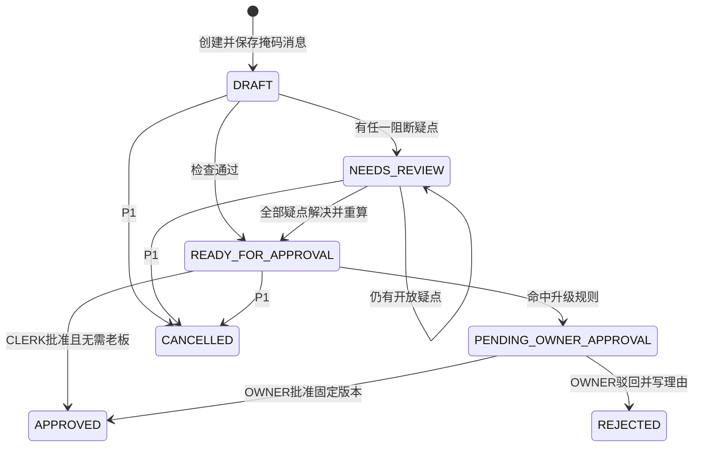

# KiraOrder v1.2 后端完整规则框架

> 契约状态：`FROZEN_v1.2`  
> 冻结日期：2026-10-21（UTC+8）  
> 负责人：He Minghao  
> 适用范围：KiraOrder for Orbyte 第一阶段/P0后端实现  
> 依据：终版执行方案 v2、2026-10-21 契约确认会议及会议后确认的Q1–Q11

## 0. 文档地位与使用规则

本文是第一阶段后端的总规则框架，也是前端、AI和数据三个对接契约的业务真相源。实现、OpenAPI、数据库迁移、测试和演示如与本文冲突，以本文为准。

文档优先级从高到低：

1. 用户在会议后的Q1–Q11确认；
2. 2026-10-21最终会议决议；
3. 终版执行方案v2中未被会议改写的业务边界；
4. 会前01–13号讨论模板中的建议值。

因此，终版执行方案中的旧状态名、旧API形态或旧分工若已被会议决议替换，不得反向覆盖本契约。任何新的冲突必须先登记为契约变更，不能由单个模块自行解释。

配套文件：

- `02_KiraOrder_v1.2_后端与前端对接规则.md`
- `03_KiraOrder_v1.2_后端与AI对接规则.md`
- `04_KiraOrder_v1.2_后端与数据对接规则.md`

冻结后只允许：

1. 修正明确错误；
2. 收缩范围；
3. 增加不破坏既有调用方的可选字段；
4. 经相关负责人确认后变更契约版本。

禁止在前端、提示词、种子数据或临时代码中绕过本文规则。

---

## 1. 产品目标与后端责任

KiraOrder把批发商收到的混语订货消息转换为核对过、批准过、可追溯的送货单（DO）。后端是唯一业务真相源，必须落实：

> AI负责读；数据和规则负责判；人负责拍板。

后端负责：

- 租户隔离、身份和角色权限；
- 原消息PII掩码与安全存储；
- AI、客户别名和离线兜底结果的验证与合并；
- 商品族到SKU的解析；
- 疑点、条件和解决动作；
- 等级价、成交价、行金额和订单总额；
- 库存展示检查和批准事务内最终检查；
- 老板升级规则和按钮允许动作；
- 草稿版本、审批快照和并发冲突；
- DO生成、库存扣减、活动记录与字段差异；
- OpenAPI、错误码和角色字段裁剪。

后端不得：

- 接受AI或前端计算的最终金额；
- 接受客户端指定的角色或租户；
- 允许AI、规则或模拟入站直接生成DO；
- 在阻断疑点未解决时批准；
- 产生负库存；
- 把离线匹配标记成AI；
- 持久化未掩码的消息原文；
- 自动发送客户澄清或回复消息。

---

## 2. 第一阶段完成定义

即使RunPod完全关闭，系统仍必须使用合成数据完成：

```text
创建消息
→ PII掩码并落库
→ 别名/离线解析
→ 创建草稿与疑点
→ 跟单员核对和解决疑点
→ 后端重算价格、库存和审批路由
→ 跟单员直接批准或提交老板
→ 原子生成DO、扣库存和写审计
→ 返回可见结果及回复草稿
```

P0必须包含：

- v1.2数据模型与迁移；
- 状态机；
- P0疑点目录；
- 三类条件的词表识别；
- 三条老板升级规则；
- 两条硬阻断规则；
- CLERK、OWNER、WAREHOUSE权限和字段裁剪；
- 草稿版本与批准快照；
- DO、库存和审计原子事务；
- AI状态与Wake AI接口；
- DO详情接口；
- 无AI闭环测试。

P1，不阻塞第一阶段：

- `CANCELLED`作废流程；
- 同日订单核对；
- 仓库独立页面；
- 模拟WhatsApp自动入站；
- 模型补充条件检测；
- 租户级别名。

P2：

- Credit/已批准DO计数器。

---

## 3. 推荐后端目录框架

```text
backend/
├── app/
│   ├── main.py
│   ├── config.py
│   └── dependencies.py
├── api/
│   ├── me.py
│   ├── drafts.py
│   ├── approvals.py
│   ├── delivery_orders.py
│   ├── activity.py
│   ├── ai.py
│   ├── inbound.py          # P1
│   └── demo.py             # 演示重置
├── domain/
│   ├── enums.py
│   ├── state.py
│   ├── issues.py
│   ├── conditions.py
│   ├── resolver.py
│   ├── calculator.py
│   ├── rules.py
│   ├── permissions.py
│   └── errors.py
├── application/
│   ├── create_draft.py
│   ├── edit_draft.py
│   ├── resolve_issue.py
│   ├── submit_approval.py
│   ├── approve_order.py
│   └── reject_order.py
├── ai/
│   ├── extractor.py
│   ├── schemas.py
│   ├── adapter.py
│   ├── fallback.py
│   ├── alias_resolver.py
│   ├── merger.py
│   ├── warmup.py
│   └── prompts/
├── comms/
│   ├── clarify.py
│   ├── reply.py
│   └── lang.py
├── privacy/
│   └── pii.py              # AI组交付，后端统一调用
├── db/
│   ├── models.py
│   ├── repositories/
│   └── migrations/
├── schemas/
│   ├── common.py
│   ├── drafts.py
│   ├── approvals.py
│   ├── delivery_orders.py
│   └── errors.py
└── tests/
    ├── unit/
    ├── integration/
    ├── contract/
    └── concurrency/
```

依赖方向必须保持：

```text
API → Application → Domain
                  ↘ Repositories/AI adapters
```

Domain规则不能依赖FastAPI请求对象、前端状态或RunPod响应原始JSON。

---

## 4. 统一命名和数据类型

### 4.1 命名规范

| 类型 | 规则 | 示例 |
|---|---|---|
| 枚举 | 大写蛇形 | `PENDING_OWNER_APPROVAL` |
| JSON字段 | 小写蛇形 | `draft_version` |
| 数据库表 | 小写复数 | `draft_versions` |
| API路径 | 小写复数 | `/api/v1/drafts/{draft_id}` |
| ID | 稳定对象前缀 | `DRF_001`、`ISS_001`、`DO_001` |
| 金额JSON | 两位小数字符串 | `"95.00"` |
| 金额内部 | `Decimal` | `Decimal("95.00")` |
| 数量文件 | 字符串 | `"5"` |
| 数量内部/数据库 | 正整数 | `5` |
| 时间存储 | UTC ISO 8601/数据库UTC | `2026-10-21T06:30:00Z` |
| 时间展示 | UTC+8 | `2026-10-21 14:30` |

### 4.2 数量规则

P0只支持正整数：

```text
合法：1、5、100
非法：0、-1、1.5、five、空值
```

小数不四舍五入、不截断、不交给RapidFuzz。保留原文并创建：

```text
issue_code = INVALID_QUANTITY
reason_code = UNSUPPORTED_DECIMAL_QUANTITY
```

### 4.3 MYR舍入

- 金额统一两位小数；
- 舍入模式：`ROUND_HALF_UP`；
- 每行先计算并量化到两位，再汇总订单总额；
- 前端提交的行金额或总额一律忽略或拒绝并由后端重算。

---

## 5. 统一枚举

### 5.1 登录角色

```text
CLERK
OWNER
WAREHOUSE
```

`CUSTOMER`和`SYSTEM`不是登录角色，只能作为疑点路由目标。

### 5.2 草稿状态

```text
DRAFT
NEEDS_REVIEW
READY_FOR_APPROVAL
PENDING_OWNER_APPROVAL
APPROVED
REJECTED
CANCELLED              # P1
```

### 5.3 疑点状态

```text
OPEN
RESOLVED
VOIDED
```

P0不设置非阻断警告；P0创建的疑点全部`blocking=true`。

### 5.4 疑点路由

```text
CUSTOMER
OWNER
CLERK
SYSTEM
```

统一字段名：`ask_target`。

### 5.5 条件类型

```text
STOCK_IF_AVAILABLE
PRICE_REQUEST
OTHER_CONDITION
```

可选子类型，例如：

```text
OTHER_CONDITION / DELIVERY_TIME
```

### 5.6 条件状态

```text
DETECTED
SATISFIED
NOT_SATISFIED
RESOLVED_BY_CLERK
```

### 5.7 抽取来源

```text
AI
FALLBACK
ALIAS_ONLY
```

来源必须记录到订单行；草稿可额外保存汇总来源。

### 5.8 AI状态

```text
OFFLINE
WARMING
READY
DEGRADED
```

### 5.9 业务动作

```text
EDIT_DRAFT
RESOLVE_ISSUE
COPY_CLARIFICATION
APPROVE_AND_GENERATE_DO
SUBMIT_FOR_OWNER
OWNER_APPROVE
OWNER_REJECT
CANCEL_DRAFT           # P1
VIEW_ACTIVITY
WAKE_AI
```

### 5.10 老板升级原因

```text
BELOW_TIER_PRICE
ORDER_TOTAL_THRESHOLD
CREDIT_TERM_NOTICE
```

---

## 6. 核心数据库对象

以下为逻辑模型。具体ORM类型可按SQLAlchemy/PostgreSQL实现，但约束不得弱化。

### 6.1 `tenants`

| 字段 | 类型 | 约束/说明 |
|---|---|---|
| `id` | string/uuid | PK，稳定ID |
| `name` | string | 非空 |
| `currency` | string | 固定`MYR` |
| `timezone` | string | `Asia/Kuala_Lumpur` |
| `owner_approval_threshold` | numeric(12,2) | 非负 |
| `active` | boolean | 非空 |

T1阈值RM1,500；T2阈值RM800。

### 6.2 `users`

| 字段 | 类型 | 约束/说明 |
|---|---|---|
| `id` | string/uuid | PK |
| `tenant_id` | FK | 必填 |
| `display_name` | string | 必填 |
| `role` | enum | CLERK/OWNER/WAREHOUSE |
| `demo_token_hash` | string | 唯一，不存明文令牌 |
| `active` | boolean | 必填 |

角色只能从令牌映射的用户记录取得，禁止`X-Mock-Role`或请求体自报角色。

### 6.3 `customers`

| 字段 | 类型 | 说明 |
|---|---|---|
| `id` | string/uuid | PK |
| `tenant_id` | FK | 必填 |
| `name` | string | 合成客户名 |
| `synthetic_phone` | string | 仅合成号段；CLERK/OWNER可见，WAREHOUSE不可见 |
| `tier` | string | A/B等 |
| `credit_term_notice` | boolean | 只是合成提醒，不代表逾期 |
| `language_preference` | string/null | ms/zh/en |
| `active` | boolean | 必填 |

### 6.4 `product_families`

| 字段 | 类型 | 说明 |
|---|---|---|
| `id` | string/uuid | PK |
| `tenant_id` | FK | 必填 |
| `name` | string | AI闭集选择对象 |
| `active` | boolean | 必填 |

### 6.5 `skus`

| 字段 | 类型 | 说明 |
|---|---|---|
| `id` | string/uuid | PK |
| `tenant_id` | FK | 必填，与family租户一致 |
| `family_id` | FK | 必填 |
| `display_name` | string | 必填 |
| `spec` | string/null | 如1kg/2kg |
| `grade` | string/null | 如A/B/C |
| `base_unit` | string | pack/ctn/kg等 |
| `active` | boolean | 必填 |

### 6.6 `customer_tier_prices`

唯一约束：

```text
UNIQUE(tenant_id, sku_id, customer_tier)
```

`unit_price`使用`numeric(12,2)`。演示所需的每个SKU/Tier组合必须存在，缺失时阻断并返回`MISSING_TIER_PRICE`。

### 6.7 `inventory`

唯一约束：

```text
UNIQUE(tenant_id, sku_id)
CHECK(available_quantity >= 0)
```

`available_quantity`为整数，单位必须与SKU的`base_unit`一致。

### 6.8 `customer_aliases`

| 字段 | 说明 |
|---|---|
| `tenant_id`、`customer_id` | 别名作用域 |
| `alias_text` | 人工确认的客户说法 |
| `target_type` | FAMILY或SKU |
| `target_id` | 当前租户内目标 |
| `confirmed_by`、`confirmed_at` | 审计 |
| `active` | 可撤销 |

不得将别名描述为模型学习或训练。

### 6.9 `inbound_messages`

| 字段 | 说明 |
|---|---|
| `id` | 消息ID |
| `tenant_id`、`customer_id` | 作用域 |
| `masked_text` | 唯一持久化文本；PII掩码后存储 |
| `received_at` | UTC |
| `source` | P0为PASTE/DEMO |

未掩码原文只在当前请求内存在，不持久化、不写日志。所有span偏移都相对于`masked_text`。

### 6.10 `drafts`

| 字段 | 说明 |
|---|---|
| `id` | PK |
| `tenant_id`、`customer_id`、`message_id` | 必填 |
| `status` | 草稿状态枚举 |
| `current_version` | 正整数，从1开始 |
| `created_by` | 用户或SYSTEM |
| `created_at`、`updated_at` | UTC |

客户端不能直接PATCH `status`或`current_version`。

### 6.11 `draft_versions`

每个版本保存可审批快照：

- 版本号；
- 订单行快照或不可变行关联；
- 价格与总额；
- 疑点状态；
- 条件解决结果；
- 升级原因；
- 创建人、原因、时间。

唯一约束：

```text
UNIQUE(draft_id, version)
```

### 6.12 `draft_lines`

核心字段：

```text
id, tenant_id, draft_id, draft_version
source_span, span_start, span_end
extraction_source
family_id nullable
sku_id nullable
quantity nullable integer
raw_quantity nullable string
raw_unit nullable string
spec_text nullable string
grade_text nullable string
tier_unit_price nullable numeric
applied_unit_price nullable numeric
line_total nullable numeric
```

未知商品行使用`family_id=null`，不能使用假的`"UNKNOWN"`外键值。

### 6.13 `issues`与`issue_resolutions`

`issues`保存稳定事实：代码、阻断标记、路由、原文证据、使用的数据、状态和所属版本。历史疑点不删除；新版本不再适用时标为`VOIDED`。

`issue_resolutions`保存：动作、前值、后值、理由、操作者、时间、是否保存客户别名。

### 6.14 `conditions`

保存：类型、子类型、状态、原文片段、偏移、检测来源（LEXICON_V0或未来AI）、系统/人工解决结果及证据。

### 6.15 `owner_escalations`

老板升级原因与普通疑点分表/分对象，保存原因代码和事实快照。规格不明确不能交给老板代替客户回答。

### 6.16 `approval_requests`与`approval_decisions`

审批请求绑定不可变的`draft_version`，保存提交时完整理由和金额快照。决定保存OWNER、批准/驳回、理由和时间。

同一草稿同时最多一个待处理请求；PostgreSQL建议使用部分唯一索引：

```sql
CREATE UNIQUE INDEX one_pending_approval_per_draft
ON approval_requests (draft_id)
WHERE status = 'PENDING';
```

### 6.17 `delivery_orders`与`delivery_order_lines`

`delivery_orders`必须：

```text
UNIQUE(draft_id)
```

一张草稿只能生成一张DO。`APPROVED`状态必定存在DO。

### 6.18 `activity_logs`与`field_diffs`

活动记录只追加、不可更新和删除。字段差异保存AI/兜底初稿与人工终稿的字段级变化、原因和操作者。

---

## 7. 状态机



### 7.1 状态不变量

1. `READY_FOR_APPROVAL`没有开放疑点；
2. `PENDING_OWNER_APPROVAL`有有效审批请求和固定版本；
3. P0等待老板期间不可编辑；
4. `APPROVED`必有且只有一张DO；
5. `REJECTED`为终态，且必须有老板理由；
6. 终态不可通过普通编辑接口修改；
7. 每次合法转换都写活动记录；
8. 批准前重新检查，不能只相信状态值。

### 7.2 OWNER能力

P0 OWNER只读草稿/审批内容并执行审批，不创建或编辑草稿。

---

## 8. P0疑点体系

| 代码 | 触发 | ask_target | 解决方式 |
|---|---|---|---|
| `UNKNOWN_PRODUCT` | 无法对应当前租户商品族 | CLERK/CUSTOMER | 人工选商品或复制澄清模板 |
| `MISSING_SPEC` | 多规格但原文缺规格 | CUSTOMER | 选择SKU或询问客户 |
| `MISSING_GRADE` | 多等级但原文缺等级 | CUSTOMER | 选择等级或询问客户 |
| `MISSING_UNIT` | 多单位但原文缺单位 | CUSTOMER | 选择单位或询问客户 |
| `INVALID_QUANTITY` | 缺失、非正整数或小数 | CLERK/CUSTOMER | 人工修正或询问客户 |
| `AMBIGUOUS_MATCH` | RapidFuzz候选过近 | CLERK | 人工选择候选 |
| `INSUFFICIENT_STOCK` | 请求量大于库存 | CUSTOMER，经CLERK沟通 | 减量并确认或澄清 |
| `PRICE_CONDITION_UNRESOLVED` | 价格条件尚未处理 | CLERK | 按等级价询问或人工接受客户价 |
| `OTHER_CONDITION_UNCONFIRMED` | 时间等条件未确认 | CLERK | 确认并写备注 |
| `SOURCE_EVIDENCE_INVALID` | span无法在掩码消息定位 | SYSTEM/CLERK | 单行兜底或人工处理 |

所有P0疑点：

```text
blocking = true
```

技术错误不得建成疑点；使用统一API错误码。

P1预留`SAME_DAY_ORDER_CHECK`，用于客户同日已有DO/未结草稿或消息含追加词时的人工核对；P0不得提前启用该规则阻断闭环。

### 8.1 解决动作

```text
SELECT_PRODUCT_FAMILY
SELECT_SKU
SET_QUANTITY
REDUCE_TO_AVAILABLE_STOCK
ASK_CUSTOMER_AT_TIER_PRICE
ACCEPT_REQUESTED_PRICE
CONFIRM_OTHER_CONDITION
USE_FALLBACK_RESULT
MARK_UNRESOLVED
```

所有改变DO内容的解决动作都创建新草稿版本。

---

## 9. 条件识别体系

### 9.1 P0权威来源

条件检测运行在后端规则层，读取版本控制的YAML词表。P1模型只补充候选，不直接改变业务路由。

### 9.2 有货条件

```text
STOCK_IF_AVAILABLE
```

处理：查询SKU库存并记录使用的数据。库存足够则`SATISFIED`；不足则`NOT_SATISFIED`并创建`INSUFFICIENT_STOCK`。即使原文是“有多少给多少”，也不能自动减量，必须由人确认。

### 9.3 价格条件

```text
PRICE_REQUEST
```

价格数字只作为原文证据，不能自动写入成交价。跟单员选择：

1. `ASK_CUSTOMER_AT_TIER_PRICE`；或
2. `ACCEPT_REQUESTED_PRICE`并人工填写成交价。

后端重算；低于等级价自动生成`BELOW_TIER_PRICE`并送老板。

### 9.4 其他条件

```text
OTHER_CONDITION
```

由CLERK确认并填写备注。P0不扩展为物流、路线或司机调度系统。

### 9.5 模板

澄清和回复由固定三语模板生成，不调用模型、不自动发送。语言选择顺序：消息主要语言优先，客户偏好兜底。P0批准后回复草稿不含价格。

---

## 10. AI、别名与Fallback统一管线

```text
请求原文（仅内存）
→ privacy/pii.py掩码
→ masked_text落库并作为唯一展示文本
→ 后端条件词表检测
→ 客户别名检测并定位区间
→ AI调用（可用时）
→ Adapter转换短键、计算masked_text偏移、逐行校验
→ 失败行单独进入RapidFuzz
→ 按原文区间合并：ALIAS_ONLY > AI > FALLBACK > unresolved
→ 商品/SKU解析
→ 创建疑点、条件和字段差异
```

### 10.1 未识别商品

保留为订单行：

```text
family_id = null
sku_id = null
保留 source_span/raw_quantity/raw_unit
创建 UNKNOWN_PRODUCT
```

禁止使用`family_id="UNKNOWN"`。

### 10.2 Adapter规则

- LLM不输出`start/end`；
- Adapter对`masked_text`定位`span`并计算Unicode字符索引；
- 精确匹配优先，再进行大小写/多余空白标准化；
- 多次出现时结合顺序和非重叠区间选择；
- 无法唯一定位时只降级该行；
- 顶层JSON损坏才整单Fallback；
- 行级问题只影响当前行；
- 未知额外字段被白名单剥离并记录日志；
- 禁止字段永不进入Domain。

### 10.3 别名去重

不能按SKU和数量简单去重。必须按原文区间判断。重叠时人工确认的客户别名优先；相同SKU在不同区间出现仍是两条合法行。

### 10.4 条件预留

AI原始Schema包含`conds: []`。P0固定为空或不参与判断；P1可填候选，但必须映射到统一三类条件并由后端验证。

---

## 11. 价格、库存与审批规则

### 11.1 价格

```text
tier_unit_price = lookup(tenant_id, sku_id, customer.tier)
applied_unit_price = tier_unit_price（默认）
line_total = quantity × applied_unit_price
order_total = Σ line_total
```

仅`ACCEPT_REQUESTED_PRICE`允许人工给出不同`applied_unit_price`。后端必须验证其为合法且严格大于0的MYR Decimal；P0不支持免费行或负价折让。

### 11.2 老板升级规则

任一命中即进入老板审批，全部命中原因同时返回：

```text
BELOW_TIER_PRICE:
  applied_unit_price < tier_unit_price

ORDER_TOTAL_THRESHOLD:
  order_total >= tenant.owner_approval_threshold

CREDIT_TERM_NOTICE:
  customer.credit_term_notice == true
```

### 11.3 两条硬规则

任何角色都不能绕过：

```text
BLOCKING_ISSUES_REMAIN
NEGATIVE_STOCK_FORBIDDEN
```

### 11.4 `allowed_actions`

后端按当前用户、草稿状态、开放疑点和升级预演实时返回`allowed_actions`；前端不得自行推导，数据库中即使缓存也不能把缓存当授权依据。

| 条件 | CLERK动作 | OWNER动作 |
|---|---|---|
| `NEEDS_REVIEW` | `EDIT_DRAFT`、`RESOLVE_ISSUE`、`COPY_CLARIFICATION`、`VIEW_ACTIVITY` | `VIEW_ACTIVITY` |
| `READY_FOR_APPROVAL`且无升级原因 | `APPROVE_AND_GENERATE_DO`、`VIEW_ACTIVITY` | `VIEW_ACTIVITY` |
| `READY_FOR_APPROVAL`且有升级原因 | `SUBMIT_FOR_OWNER`、`VIEW_ACTIVITY` | `VIEW_ACTIVITY` |
| `PENDING_OWNER_APPROVAL` | `VIEW_ACTIVITY`，不可编辑/决定 | `OWNER_APPROVE`、`OWNER_REJECT`、`VIEW_ACTIVITY` |
| `APPROVED`或`REJECTED` | 只读授权能力 | 只读授权能力 |

`WAKE_AI`是独立系统能力，CLERK/OWNER可见且受限流；它不改变草稿状态或版本。

### 11.5 库存检查

1. 草稿展示阶段检查，用于生成疑点和说明；
2. 批准事务内锁行后重新检查，作为最终业务保证。

---

## 12. 权限与字段裁剪

### 12.1 CLERK

可以：创建/解析、编辑草稿、解决疑点、复制模板、批准普通单、提交老板、查看自己提交的审批状态但不能替老板操作。

### 12.2 OWNER

P0可以：查看审批所需完整信息、批准、驳回、查看活动。不能创建或编辑草稿。

### 12.3 WAREHOUSE

P0后端提供裁剪后的已批准DO数据；独立页面P1。可以看到DO编号、客户名称、SKU、数量、单位和拣货备注。不得看到电话、Tier、价格、总额、账期提醒、原消息或AI/人工差异。

### 12.4 多租户隔离

所有查询必须同时使用对象ID和当前用户`tenant_id`。跨租户访问统一404，避免泄露对象存在。

### 12.5 响应模型

使用显式模型：

```text
ClerkDraftResponse
OwnerApprovalResponse
WarehouseDOResponse
```

禁止先返回完整对象再依靠前端隐藏。

---

## 13. 草稿版本、批准事务与并发

### 13.1 增加版本的操作

- 选择/更换SKU；
- 修改数量或单位；
- 添加/删除订单行；
- 接受客户价；
- 解决影响DO内容的疑点；
- 确认其他条件；
- 任何影响老板升级判断的修改。

查看、复制模板、Wake AI不增加版本。

### 13.2 批准请求

CLERK对当前已保存版本执行批准/提交老板时，统一调用`POST /api/v1/drafts/{id}/approve`，请求只携带：

```json
{
  "draft_version": 3
}
```

不得携带明细、总额、动作路由或`requires_owner`。后端重算规则后决定结果：

- 没有老板升级原因：在批准事务内生成DO，返回`200`；
- 存在老板升级原因：创建绑定当前版本的审批请求、进入`PENDING_OWNER_APPROVAL`，返回`202`；
- 前端的`APPROVE_AND_GENERATE_DO`和`SUBMIT_FOR_OWNER`只是同一接口在不同规则结果下的文案，不得改变路由判断。

老板驳回请求额外要求非空`reason`。

### 13.3 等待老板期间

P0不允许编辑。内容有误时由老板驳回，原草稿进入`REJECTED`终态；跟单员从原消息创建新草稿。

### 13.4 原子批准事务

CLERK提交当前版本时，在一个数据库事务中：

1. 认证用户并取得租户；
2. 验证角色和对象租户；
3. 验证草稿状态和提交版本；
4. 重新读取开放疑点；
5. 重新读取客户、Tier、阈值和提醒；
6. 重查等级价，使用Decimal重算金额；
7. 重算全部老板升级原因；
8. 若存在升级原因：创建绑定当前`draft_version`的审批请求，保存全部原因和金额快照，将草稿置为`PENDING_OWNER_APPROVAL`，写活动记录，提交并返回`202 ApprovalRequest`；此分支不得创建DO或扣库存；
9. 若不存在升级原因：按`sku_id`稳定顺序锁定库存行；
10. 重新检查库存；
11. 创建DO和DO明细；
12. 扣减库存；
13. 写批准决定、字段差异和活动记录；
14. 更新草稿为`APPROVED`；
15. 提交并返回`200 DeliveryOrder`。

OWNER批准待办时复用DO生成事务，并额外验证：审批请求仍为`PENDING`、审批绑定版本等于草稿当前版本、草稿仍为`PENDING_OWNER_APPROVAL`、硬规则仍满足。随后重算价格和全部升级原因、按`sku_id`加锁并复核库存，再原子创建DO、扣库存、写决定/审计并进入`APPROVED`。

任一步失败全部回滚。

### 13.5 防重复

不增加`idempotency_key`。使用：

```text
UNIQUE(delivery_orders.draft_id)
```

重复批准返回`409 ALREADY_APPROVED`。

### 13.6 并发库存

同一SKU最后库存并发批准时，只允许一个事务成功。失败事务返回`409 INSUFFICIENT_STOCK`，不得生成DO或部分扣减。

---

## 14. 活动记录与差异审计

建议事件：

```text
DRAFT_CREATED
EXTRACTION_COMPLETED
EXTRACTION_FALLBACK_USED
ISSUE_CREATED
ISSUE_RESOLVED
DRAFT_VERSION_CREATED
OWNER_APPROVAL_REQUESTED
OWNER_APPROVED
OWNER_REJECTED
DO_CREATED
INVENTORY_DEDUCTED
ALIAS_SAVED
ACCESS_DENIED
DRAFT_CANCELLED       # P1
```

活动记录只追加。已认证用户的越权写操作记录`ACCESS_DENIED`，但对外仍按403/404策略响应；不得在事件中记录密钥、授权头、未掩码PII或可泄露跨租户对象存在性的明细。

字段差异最少保存：

```text
field_path
before_value
after_value
reason_code
changed_by
draft_version
changed_at
```

---

## 15. P0 API框架

基础规则：`/api/v1`、成功响应包裹`data/meta`、金额字符串、角色裁剪、写操作验证版本。

| 方法与路径 | 能力 | 角色 |
|---|---|---|
| `GET /api/v1/me` | 用户、角色、租户、权限摘要 | 全部 |
| `POST /api/v1/drafts/parse` | 创建消息和草稿，执行解析管线 | CLERK |
| `GET /api/v1/drafts` | 草稿列表，默认limit 50、最大100 | CLERK/OWNER |
| `GET /api/v1/drafts/{id}` | 角色裁剪详情 | CLERK/OWNER |
| `PATCH /api/v1/drafts/{id}` | 保存人工修改并增版本 | CLERK |
| `POST /api/v1/drafts/{id}/issues/{issue_id}/resolve` | 解决疑点 | CLERK |
| `POST /api/v1/drafts/{id}/approve` | 提交当前版本；无升级返回200 DO，有升级创建待办并返回202 | CLERK |
| `GET /api/v1/approvals` | 老板待办；CLERK可看自己提交状态 | OWNER/受限CLERK |
| `POST /api/v1/approvals/{id}/approve` | 老板批准固定版本 | OWNER |
| `POST /api/v1/approvals/{id}/reject` | 老板驳回 | OWNER |
| `GET /api/v1/activity` | 活动时间线 | CLERK/OWNER |
| `GET /api/v1/delivery-orders/{id}` | DO详情，按角色裁剪 | 全部授权角色 |
| `GET /api/v1/ai/status` | AI运行状态 | CLERK/OWNER |
| `POST /api/v1/ai/wake` | 限流的人工预热 | CLERK/OWNER |

可增加但不阻塞：`POST /api/v1/demo/reset`。模拟入站与仓库列表为P1。

### 15.1 列表规则

- 默认`limit=50`；
- 最大`limit=100`；
- P0不做复杂游标分页；
- 返回`count`；
- 默认按`updated_at desc`；
- 可按状态过滤。

### 15.2 成功响应

```json
{
  "data": {},
  "meta": {
    "request_id": "REQ_001"
  }
}
```

### 15.3 错误响应

```json
{
  "error": {
    "code": "DRAFT_VERSION_CONFLICT",
    "message": "Draft has changed. Reload the latest version.",
    "details": {
      "submitted_version": 3,
      "current_version": 4
    },
    "request_id": "REQ_002"
  }
}
```

### 15.4 错误码

| HTTP | 错误码 | 含义 |
|---:|---|---|
| 400 | `INVALID_REQUEST` | 请求结构无法理解 |
| 401 | `INVALID_TOKEN` | 缺失/无效令牌 |
| 403 | `FORBIDDEN_ACTION` | 角色无权操作 |
| 404 | `RESOURCE_NOT_FOUND` | 不存在或跨租户 |
| 409 | `DRAFT_VERSION_CONFLICT` | 旧版本 |
| 409 | `ALREADY_APPROVED` | 重复批准 |
| 409 | `INVALID_STATE_TRANSITION` | 状态不允许 |
| 409 | `INSUFFICIENT_STOCK` | 事务内库存变化 |
| 422 | `BLOCKING_ISSUES_REMAIN` | 疑点未解决 |
| 422 | `REJECTION_REASON_REQUIRED` | 驳回缺理由 |
| 422 | `MISSING_TIER_PRICE` | 配置缺失，不能猜价 |
| 422 | `INVALID_QUANTITY` | 非正整数或小数 |
| 422 | `INVALID_ISSUE_RESOLUTION` | 解决动作不适用 |
| 422 | `MESSAGE_TOO_LONG` | 超过4000 Unicode字符 |
| 429 | `AI_WAKE_RATE_LIMITED` | Wake AI调用过频 |
| 503 | `AI_AND_FALLBACK_UNAVAILABLE` | 两条解析路径均不可用 |

状态/并发冲突使用409；输入或业务规则不满足使用422。

---

## 16. AI运行与安全配置

| 配置 | 规则 |
|---|---|
| `MAX_MESSAGE_CHARS` | 默认4000，可通过环境变量调整；原始输入与掩码结果均按Unicode码点检查，任一超限即422且不落库 |
| `LLM_TIMEOUT_S` | 热态实测p95+1秒，上限8秒 |
| 自动重试 | P0不重试，超时立即逐行/整单进入Fallback |
| 自动预热 | 打开工作台触发一次异步预热 |
| 人工预热 | `POST /ai/wake`，必须限流 |
| 评审期worker | min workers=0 |
| 录制期 | 可常驻1个worker |

日志只记录request_id、模型版本、耗时、状态、失败原因和来源，不记录RunPod Key、授权头、未掩码消息或不必要的完整提示词。

---

## 17. 测试体系

### 17.1 单元测试

- 金额Decimal与`ROUND_HALF_UP`；
- 正整数数量验证；
- 三条老板升级规则的单独与组合命中；
- 两条硬规则；
- 条件词表正例/负例；
- 疑点创建与解决动作；
- 状态转换；
- 角色允许动作；
- 字段裁剪；
- Adapter短键映射、偏移定位和额外字段剥离；
- 别名/AI/Fallback按区间合并。

### 17.2 契约测试

- AI请求和原始响应Schema；
- ExtractionResult内部Schema；
- OpenAPI成功/错误样例；
- 种子JSON和词表YAML Schema；
- 前端枚举与后端OpenAPI一致。

### 17.3 集成测试

- 普通订单直接批准；
- 缺规格必须问客户；
- 有货条件满足/不满足；
- 接受低价送老板；
- 同一消息换客户产生不同路由；
- 同金额在T1/T2产生不同路由；
- 提示注入不能改价格；
- AI关闭仍可闭环；
- 版本冲突；
- 老板驳回终态；
- 仓库响应无价格和电话。

### 17.4 并发测试

- 双击批准只生成一张DO；
- 两个草稿竞争最后库存只允许一个成功；
- 任一步失败时DO、库存、审批和活动全部回滚。

### 17.5 安全测试

- 请求头不能冒充角色；
- T1令牌不能访问T2对象；
- AI不能返回目录外有效family；
- 未掩码原文不进入数据库和日志；
- WAREHOUSE响应中不存在敏感字段；
- 前端提交总额不能覆盖后端计算。

---

## 18. 第一阶段实施顺序

### 阶段A｜契约与骨架

1. 实现`enums.py`、错误码和统一响应；
2. 建立OpenAPI骨架和请求/响应模型；
3. 建立数据库迁移；
4. 提供前端Mock和AI/Data Schema。

### 阶段B｜纯Domain规则

1. 金额计算器；
2. 状态机；
3. 疑点与条件；
4. 老板升级规则；
5. 角色允许动作；
6. 固定三语模板；
7. 单元测试。

### 阶段C｜无AI应用闭环

1. 固定seed导入；
2. PII掩码；
3. Alias/Fallback；
4. 草稿编辑与版本；
5. 普通/老板批准事务；
6. DO、库存与审计；
7. 端到端测试。

### 阶段D｜AI接入

1. RunPod客户端；
2. 短键Adapter；
3. 行级校验与降级；
4. 别名/AI/Fallback合并；
5. 状态灯、自动预热与Wake AI；
6. AI/Fallback对照测试。

### 阶段E｜证据与冻结

1. 跑开发集；
2. 不读取答案键的评测脚本；
3. 冻结集SHA-256；
4. 保存测试、日志和截图；
5. OpenAPI与README同步。

---

## 19. 后端交付清单

- [ ] 数据库迁移可从空库执行。
- [ ] 两租户seed可重复导入。
- [ ] OpenAPI可访问并与实现一致。
- [ ] 所有枚举只有一处定义。
- [ ] P0疑点、条件和规则有单元测试。
- [ ] 无AI闭环通过。
- [ ] AI逐行降级和来源标记通过。
- [ ] 三角色权限和字段裁剪通过。
- [ ] 版本冲突、重复批准和库存并发通过。
- [ ] APPROVED必有DO。
- [ ] REJECTED不可再次修改。
- [ ] 活动记录只追加。
- [ ] 未掩码原文不落库、不进日志。
- [ ] 冻结集答案键不被应用读取。
- [ ] 所有对外能力与演示材料真实一致。

