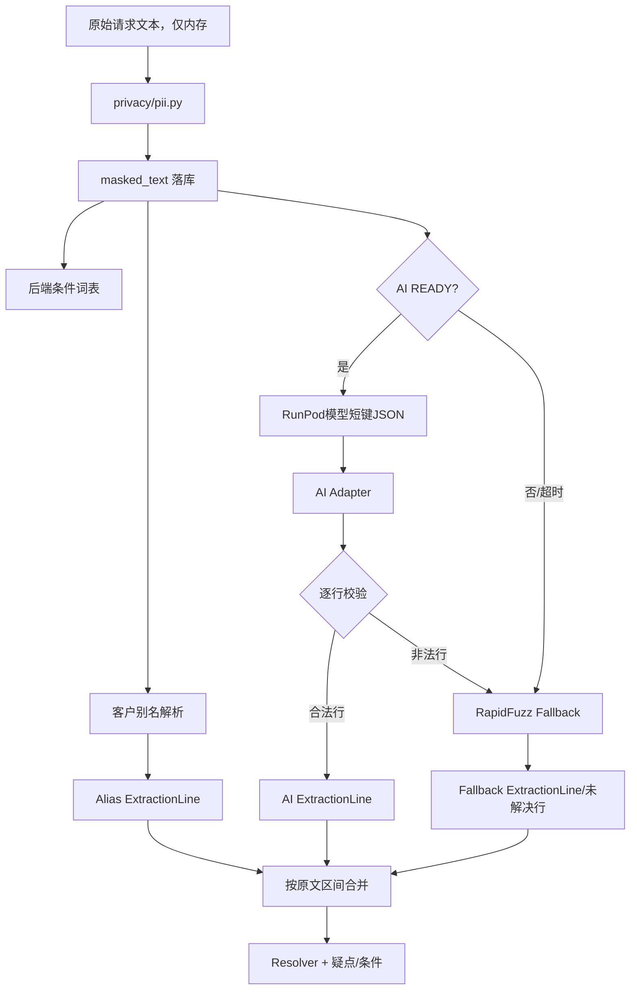

# KiraOrder v1.2 后端与AI对接规则

> 契约状态：`FROZEN_v1.2`  
> 后端负责人：He Minghao  
> AI与部署负责人：Xiong Peicheng  
> 前置真相源：`01_KiraOrder_v1.2_后端完整规则框架.md`

## 0. 目的

本文固定RunPod模型、PII模块、后端AI Adapter、客户别名和RapidFuzz兜底之间的边界，使AI可替换、可验证、可逐行降级，并且永远不能改变价格、库存和审批决定。

核心原则：

> 模型只负责从文本中读出候选事实；Adapter负责把不可信模型输出转换成受控内部对象；Domain负责最终业务判断。

---

## 1. 责任划分

| AI组负责 | 后端负责 |
|---|---|
| `privacy/pii.py`正则掩码模块 | 在落库和调用AI前统一调用掩码模块 |
| RunPod端点、模型、提示词和原始短键Schema | 认证、租户闭集准备、超时和调用 |
| 健康检查、预热和模型标识 | AI状态聚合、Wake AI限流和前端接口 |
| 从混语文本识别商品族、数量、单位、规格和等级文字 | Adapter校验、偏移计算、逐行降级与业务解析 |
| P1可补充条件候选 | P0词表为权威，条件业务判断全部在后端 |
| 输出原文片段 | 验证片段、闭集和数量，并生成疑点 |

AI组不得决定：

- 最终SKU（信息不足时）；
- 客户等级价；
- 成交价；
- 行金额或总额；
- 库存是否足够；
- 是否需要老板；
- 是否批准；
- 是否自动发送消息。

---

## 2. 端到端处理管线



优先级：

```text
ALIAS_ONLY > AI > FALLBACK > unresolved line
```

优先级只用于同一原文区间重叠。相同SKU在不同区间出现时不得误去重。

---

## 3. PII掩码契约

### 3.1 模块接口

AI组提供：

```python
def mask_pii(text: str) -> MaskedText:
    ...
```

建议返回：

```python
class MaskedText:
    text: str
    detected_types: list[str]
    replacement_count: int
```

不得返回或记录密钥。若实现需要原文到掩码的映射，映射只存在当前请求内，不持久化。

### 3.2 后端调用时点

```text
收到请求
→ 检查字符上限
→ mask_pii
→ 只持久化masked_text
→ 条件、别名、AI和Fallback全部使用masked_text
```

未掩码原文：

- 不落数据库；
- 不写日志；
- 不写异常追踪；
- 不写活动记录；
- 请求结束后不保留。

### 3.3 偏移基准

所有`source_span/start/end`以持久化的`masked_text`为基准。前端也展示`masked_text`，因此偏移和高亮一致。

### 3.4 掩码最低覆盖

- 马来西亚电话号码；
- IC样式号码；
- 明显邮箱地址（如开发集包含）；
- 其他终版测试指定的PII模式。

所有演示数据仍必须是合成数据；掩码不是使用真实数据的许可。

---

## 4. 后端发给RunPod的请求

```json
{
  "schema_version": "1.2",
  "request_id": "REQ_001",
  "tenant_id": "T1",
  "message_id": "MSG_001",
  "masked_text": "Boss, Milo 5 pack kalau ada",
  "allowed_families": [
    {
      "family_id": "FAM_MILO",
      "display_name": "Milo",
      "aliases": ["milo", "美禄", "milo powder"]
    }
  ]
}
```

### 4.1 请求规则

- `tenant_id`来自认证上下文和数据库，不来自前端自由指定；
- `allowed_families`只包含当前租户的启用商品族；
- P0传商品族和必要别名，不传最终价格和库存；
- 不传客户电话、未掩码文本或RunPod密钥；
- 原始输入与`masked_text`都必须不超过`MAX_MESSAGE_CHARS=4000`个Unicode码点；
- 任一超限由后端在持久化和AI调用前返回422 `MESSAGE_TOO_LONG`。

### 4.2 不允许发送给模型的数据

```text
tier prices
applied prices
order total
inventory quantity
credit_term_notice
approval threshold
approval history
RunPod API key
```

模型不需要这些数据，也不能据此作业务决定。

---

## 5. RunPod模型原始输出Schema

模型原始JSON使用短键，减少输出Token和键名错误：

```json
{
  "schema_version": "1.2",
  "request_id": "REQ_001",
  "lines": [
    {
      "span": "Milo 5 pack",
      "fam": "FAM_MILO",
      "qty": "5",
      "uom": "pack",
      "size": null,
      "grade": null
    }
  ],
  "conds": [],
  "ignored_spans": ["Boss"],
  "detected_language": "mixed"
}
```

`model_id`和推理延迟建议由RunPod服务包装层添加，不要求模型在生成JSON时自行写入。

数组上限：`lines`最多12项，`conds`最多4项；超过上限属于顶层结构无效并整单进入Fallback。P0数据集每条消息最多8个商品，因此该上限保留安全余量。

### 5.1 行字段定义

| 短键 | 含义 | 规则 |
|---|---|---|
| `span` | 当前商品行的原文片段 | 必须来自`masked_text`；不含start/end |
| `fam` | 商品族ID | 闭集ID或`null`；禁止字符串`UNKNOWN` |
| `qty` | 原始数量 | 字符串；由Adapter验证正整数 |
| `uom` | 原始单位文字 | 不确定时`null` |
| `size` | 规格文字 | 不确定时`null`，不能猜 |
| `grade` | 等级文字 | 不确定时`null`，不能猜 |

### 5.2 未识别商品

模型认为文本是商品行但无法对应闭集时：

```json
{
  "span": "生抽王 2 箱",
  "fam": null,
  "qty": "2",
  "uom": "箱",
  "size": null,
  "grade": null
}
```

这条记录必须保留在`lines`中；不能放入`ignored_spans`。

### 5.3 `ignored_spans`

仅用于明确不是商品的问候、闲聊和无关文本，例如：

```json
{
  "ignored_spans": ["Boss 早安", "谢谢"]
}
```

### 5.4 `conds`

P0固定返回空数组或被Adapter视为空：

```json
{
  "conds": []
}
```

P1可返回候选：

```json
{
  "span": "kalau ada",
  "kind": "STOCK_IF_AVAILABLE",
  "subtype": null
}
```

允许的`kind`只使用统一三类：

```text
STOCK_IF_AVAILABLE
PRICE_REQUEST
OTHER_CONDITION
```

模型条件只是候选，P0词表和后端规则仍为权威。

### 5.5 模型禁止字段

```text
start
end
tier_unit_price
applied_unit_price
line_total
order_total
stock_available
requires_owner
approved
final_sku_id（存在歧义时）
```

---

## 6. Adapter标准内部对象

`backend/ai/adapter.py`把模型短键转换为统一`ExtractionResult`：

```json
{
  "schema_version": "1.2",
  "request_id": "REQ_001",
  "model_id": "qwen2.5-7b-instruct-awq",
  "lines": [
    {
      "source_span": "Milo 5 pack",
      "span_start": 6,
      "span_end": 17,
      "family_id": "FAM_MILO",
      "quantity": 5,
      "raw_quantity": "5",
      "raw_unit": "pack",
      "spec_text": null,
      "grade_text": null,
      "extraction_source": "AI",
      "validation_status": "VALID"
    }
  ],
  "condition_candidates": [],
  "ignored_spans": ["Boss"]
}
```

### 6.1 映射

| 模型短键 | 内部标准字段 |
|---|---|
| `span` | `source_span` |
| Adapter计算 | `span_start/span_end` |
| `fam` | `family_id` |
| `qty` | `raw_quantity`，验证后成为`quantity` |
| `uom` | `raw_unit` |
| `size` | `spec_text` |
| `grade` | `grade_text` |
| `conds` | `condition_candidates` |

### 6.2 为什么Adapter由后端维护

- Domain不应理解模型短键；
- 更换模型不影响业务层；
- 可在一处做闭集、偏移、数量和额外字段校验；
- AI与Fallback最终返回相同`ExtractionResult`；
- 前端不会看到模型原始JSON。

---

## 7. Adapter验证流程

### 7.1 顶层验证

以下失败导致整个AI响应进入Fallback：

- HTTP失败或超时；
- 不是JSON；
- 顶层不是对象；
- 缺失`lines`；
- `lines`不是数组；
- `schema_version`不支持；
- 响应超过合理大小限制。

### 7.2 逐行验证

每行独立执行：

1. 只保留白名单字段；
2. 记录被剥离字段名，不记录敏感内容；
3. 检查`span`非空；
4. 在`masked_text`定位span；
5. 计算Unicode字符索引；
6. 检查`fam`为本租户闭集ID或`null`；
7. 检查`qty`是否为正整数字符串；
8. 标准化可空字段；
9. 转换为内部对象；
10. 失败时只降级当前行。

### 7.3 额外字段

模型多返回字段时：

- Adapter白名单剥离；
- 记录`stripped_field_names`用于调试；
- 不让价格、库存或审批字段进入内部对象；
- 不因单行多一个字段拖垮整单。

若整个顶层结构损坏，才整单Fallback。

### 7.4 偏移计算

模型不计算`start/end`。Adapter：

1. 对`masked_text`执行精确子串匹配；
2. 找不到时尝试大小写不敏感和多余空白标准化；
3. 多次出现时结合模型行顺序和已占用区间选择非重叠结果；
4. 无法唯一确定时把当前行标为`SOURCE_EVIDENCE_INVALID`并进入Fallback/人工处理；
5. 索引定义为Python Unicode码点索引，区间为半开区间`[span_start, span_end)`；前端必须转换JavaScript UTF-16下标后再高亮。

### 7.5 数量验证

合法格式：

```regex
^[1-9][0-9]*$
```

处理：

| qty | 结果 |
|---|---|
| `"5"` | 转为整数5 |
| `"0"` | `INVALID_QUANTITY` |
| `"-2"` | `INVALID_QUANTITY` |
| `"1.5"` | `INVALID_QUANTITY/UNSUPPORTED_DECIMAL_QUANTITY` |
| `"five"` | `INVALID_QUANTITY` |
| `null` | 数量缺失疑点 |

数量错误不交给RapidFuzz重新拆数字，不得导致500。

### 7.6 闭集校验

- 非空`fam`必须属于本请求的`allowed_families`；
- 目录外ID不进入Domain；
- 目录外ID当前行进入Fallback；
- 仍不能确定时保留行并使用`family_id=null`，创建`UNKNOWN_PRODUCT`；
- `null`本身不是非法，代表模型承认无法识别。

---

## 8. 单行降级

一张订单中某行失败不得让其他合法行丢失。

```text
AI合法行 → 保留AI
AI非法行 → 对该source_span/局部文本运行Fallback
Fallback唯一匹配 → 使用FALLBACK并记录分数
Fallback候选过近 → AMBIGUOUS_MATCH
Fallback无候选 → family_id=null + UNKNOWN_PRODUCT
```

只有顶层响应不可解析时，才对整条消息运行Fallback。

每行必须记录自己的`extraction_source`，不能只在草稿顶层写一个来源。

---

## 9. 客户别名与AI合并

### 9.1 别名作用域

```text
tenant_id + customer_id + alias_text
```

别名由人工确认、可撤销，不是模型训练。

### 9.2 去重规则

合并依据`span_start/span_end`：

- 区间重叠时ALIAS_ONLY优先于AI；
- AI优先于FALLBACK；
- 非重叠的相同SKU保留为不同订单行；
- 不得用`sku_id + quantity`简单去重；
- 合并决策写日志/活动证据。

### 9.3 P0调用策略

P0允许AI读取完整`masked_text`，由Adapter按区间合并。暂不强制只向AI发送未命中子句，因为可靠分句本身会增加错误风险。

如果后续分句器通过开发集验证，可优化为只发送未覆盖子句，但不得改变内部`ExtractionResult`契约。

---

## 10. RapidFuzz Fallback契约

Fallback不是AI，输出必须使用同一内部对象：

```json
{
  "source_span": "milo besar 5 pack",
  "family_id": "FAM_MILO",
  "quantity": 5,
  "raw_unit": "pack",
  "extraction_source": "FALLBACK",
  "match_score": 94.0,
  "second_score": 71.0
}
```

放行不能使用模型自报置信度。模糊匹配阈值由开发集确定，至少考虑：

- 第一候选得分；
- 第一与第二候选的分差；
- 当前租户目录；
- 客户级别名是否命中。

阈值写入后端配置并留测试证据。候选过近创建`AMBIGUOUS_MATCH`。

---

## 11. 条件候选与后端词表

P0：

- 后端YAML词表检测是权威来源；
- 模型`conds`固定为空或不参与路由；
- 有货事实由库存判断；
- 价格条件由人选择；
- 其他条件由CLERK确认。

P1：

- 模型可补充词表未命中的候选；
- Adapter校验`span`和统一`kind`；
- 仍由后端创建条件并执行规则；
- 模型候选不得自动改变成交价、库存或审批路由。

---

## 12. 超时、冷启动和状态

### 12.1 超时

```text
LLM_TIMEOUT_S = 热态实测p95 + 1秒
最大8秒
```

P0超时后不自动重试，立即进入Fallback。重试可能叠加冷启动并拖慢用户流程。

### 12.2 状态定义

| 状态 | 判定 |
|---|---|
| `OFFLINE` | 无法连接或端点明确不可用 |
| `WARMING` | 已发送预热且尚未就绪 |
| `READY` | 健康检查通过，可正常推理 |
| `DEGRADED` | 连续超时/部分失败，业务使用Fallback |

### 12.3 自动预热

打开工作台时后端异步触发一次，不阻塞页面和解析。不要由浏览器直接访问RunPod。

### 12.4 Wake AI

`POST /api/v1/ai/wake`：

- CLERK/OWNER可调用；
- 必须按用户/租户/端点限流；
- 重复调用返回当前状态或429；
- 不返回任何密钥；
- P0建议60秒内同一租户最多一次，可由配置调整。

### 12.5 评审部署

- 评审期min workers=0；
- 录制视频时可常驻1个worker；
- AI未就绪时明确显示`Offline match · non-AI`；
- AI状态不影响人工闭环。

---

## 13. 日志和可观测性

允许记录：

```text
request_id
tenant_id（内部ID）
model_id
schema_version
latency_ms
timeout flag
ai_status
line_count
valid_line_count
fallback_line_count
stripped_field_names
validation_error_codes
```

禁止记录：

- RunPod API Key；
- 完整Authorization；
- 未掩码消息；
- IC、电话或邮箱原文；
- 不必要的完整Prompt；
- 模型返回的禁止业务字段值。

---

## 14. AI相关API

### 14.1 状态

```http
GET /api/v1/ai/status
```

```json
{
  "data": {
    "status": "WARMING",
    "last_checked_at": "2026-10-21T06:30:00Z",
    "fallback_available": true,
    "message": "AI is warming up; offline matching remains available."
  },
  "meta": {"request_id": "REQ_AI_001"}
}
```

### 14.2 唤醒

```http
POST /api/v1/ai/wake
```

```json
{
  "data": {
    "status": "WARMING"
  },
  "meta": {"request_id": "REQ_AI_002"}
}
```

---

## 15. Prompt最低要求

提示词必须明确：

- 只能使用提供的`allowed_families`；
- 不确定时`fam=null`；
- 缺规格/等级/单位时使用`null`；
- 不输出价格、库存、金额或批准结论；
- 每一行返回原文`span`；
- `qty`保留字符串；
- 只输出JSON；
- 非商品闲聊进入`ignored_spans`；
- 商品无法识别仍留在`lines`；
- 不输出`start/end`。

提示词不能被用来替代后端校验。

---

## 16. 契约测试

### 16.1 Schema与Adapter

- [ ] 正常短键JSON能转换成长键内部对象。
- [ ] LLM不需要返回start/end。
- [ ] Adapter能对中英巫混排计算Unicode偏移。
- [ ] 相同span多次出现时能稳定定位或只降级该行。
- [ ] 额外字段被剥离并记录。
- [ ] `price`等禁止字段不进入内部对象。
- [ ] `fam=null`保留为未知商品行。
- [ ] 目录外fam只降级当前行。
- [ ] 小数数量创建`INVALID_QUANTITY`，不抛500。

### 16.2 单行降级

- [ ] 五行中一行失败，其他四行保留AI来源。
- [ ] 失败行可由Fallback恢复。
- [ ] Fallback仍不唯一时创建`AMBIGUOUS_MATCH`。
- [ ] 完全未知时保留行并创建`UNKNOWN_PRODUCT`。

### 16.3 Alias合并

- [ ] 同一区间Alias与AI重复时保留Alias。
- [ ] 不同区间同SKU不会误去重。
- [ ] 每行来源正确。
- [ ] ALIAS_ONLY全命中时不调用RunPod。

### 16.4 安全

- [ ] T1请求看不到T2商品族。
- [ ] 未掩码原文不落库、不进日志。
- [ ] 模型无法写价格和批准。
- [ ] Prompt注入`price RM0.01`不改变后端价格。

### 16.5 超时与状态

- [ ] 超时后不自动重试并进入Fallback。
- [ ] AI关闭时仍能生成草稿。
- [ ] 工作台预热不阻塞页面。
- [ ] Wake AI限流有效。
- [ ] READY/OFFLINE/WARMING/DEGRADED能正确展示。

---

## 17. AI组交付清单

- [ ] `privacy/pii.py`及单元测试。
- [ ] RunPod端点和Secrets配置说明。
- [ ] AWQ/FP16热态延迟对比。
- [ ] 模型原始JSON Schema。
- [ ] Prompt版本和模型ID。
- [ ] 健康检查/预热接口。
- [ ] 合法、未知商品、缺规格和注入示例输出。
- [ ] 超时和故障模拟方法。
- [ ] RunPod使用证明截图，不包含密钥。
- [ ] 与后端共同通过全部契约测试。

## 18. 后端交付清单

- [ ] PII模块在落库和AI调用前被统一执行。
- [ ] `MAX_MESSAGE_CHARS=4000`可配置。
- [ ] `LLM_TIMEOUT_S`可配置且≤8秒。
- [ ] Adapter短键映射和白名单完成。
- [ ] start/end由Adapter计算。
- [ ] 单行校验失败只降级当前行。
- [ ] Alias/AI/Fallback按区间合并。
- [ ] 原始模型输出不直接进入数据库和前端。
- [ ] 条件模型候选不直接改变业务路由。
- [ ] AI状态、自动预热和Wake AI完成。
- [ ] AI关闭时无AI闭环通过。

