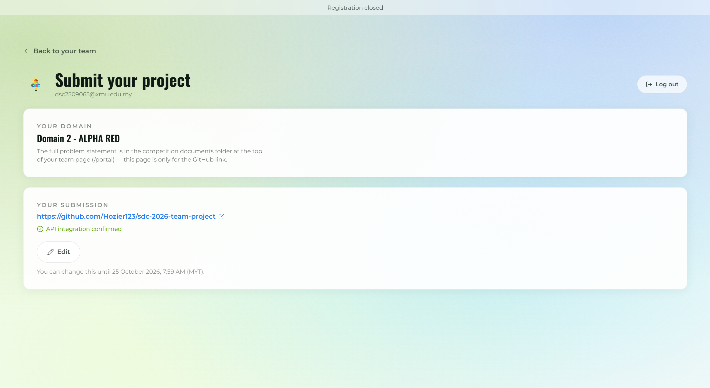

# Submission materials

Team: **Falcons** — Project: **KiraOrder for Orbyte**
Domain 2 (Orbyte Smart SME Challenge) · SDG 8 (targets 8.2, 8.3)

## Completed deliverables

The proposal and Technical & Tools Declaration follow the official SDC templates, are signed by the team leader and dated 2026/10/25.

| File | Contents | SHA-256 |
| --- | --- | --- |
| [SDC2026_Falcons_Preliminary.pdf](SDC2026_Falcons_Preliminary.pdf) | Phase 1 preliminary project proposal (official submission template, 8 pages incl. Appendix A architecture) | `5cb6985f9b7868c2253d2ffde99d5fff84ba2e0c98d298c56486ab0bf1baf66d` |
| [SDC2026_Falcons_TechDeclaration.pdf](SDC2026_Falcons_TechDeclaration.pdf) | 17-page Technical & Tools Declaration, supplied ChecklistConfirmed_Final edition, incl. Appendices A–F | `14c46ddce9619cb7786de29f3a185ae7aed9d206bcf2ff7a010428f7eb4a2a51` |

## Final-round deck (2026-11-01)

The final-round deck supersedes the 15-slide preliminary deck, whose PDF and PPTX were removed from this folder on 2026-11-01 to avoid two competing pitch decks; both files remain recoverable from Git history. Two files are published: the deck that matches the live pitch, and the long-form technical record.

| File | Contents | SHA-256 |
| --- | --- | --- |
| [SDC2026_Falcons_PitchDeck.pptx](SDC2026_Falcons_PitchDeck.pptx) | 17 slides; the deck built for the 10-minute final pitch - problem, product, architecture, evidence, business | `ce06174cde0a39c28ac31492bca03ed8edeb565dd10761c7e1c5da8d643e6515` |
| [SDC2026_Falcons_Deck_Appendix.pptx](SDC2026_Falcons_Deck_Appendix.pptx) | 28 slides; long-form technical dossier - stack, data layer, AI contract, rules, approval, evidence pages | `29aa5ad6c70b265593c771cb1ac7446ab77f2956886e451b1bc792c779ac71de` |

The live presentation is delivered from an HTML build of the same 17 pages; the `.pptx` above is the offline-checkable rendering of that same narrative. The appendix deck is a technical record and was not shown on stage. Both files were opened and slide-checked before this commit.

The proposal and Technical & Tools Declaration PDFs are also the documents to be uploaded to the official submission portal (`sdchack.my`). Publishing them in this repository is **not** a substitute for submitting through the portal.

The pitch deck PDF is provided for convenient viewing. The original PowerPoint is retained as the editable presentation source.

## Platform-use evidence

Existing Replit deployment and RunPod screenshots remain reproduced inside `SDC2026_Falcons_TechDeclaration.pdf` (Appendices B–D); related evidence records are archived under [`../evidence/`](../evidence/), with Replit screenshots in [`../evidence/replit/2026-10-24/`](../evidence/replit/2026-10-24/) and RunPod screenshots in [`../evidence/runpod/2026-10-24/`](../evidence/runpod/2026-10-24/).

The following standalone usage-proof PDFs were added on 2026/10/25. They are byte-for-byte copies of the supplied Revision 2 files, with only the `(1)` filename suffix removed. SHA-256 values below were calculated from the uploaded files.

| Attachment | Coverage | SHA-256 |
| --- | --- | --- |
| [RunPod_Usage_Proof_Falcons.pdf](RunPod_Usage_Proof_Falcons.pdf) | 8 pages; endpoint configuration, zero-worker snapshot, shutdown logs, evaluation references and explicit evidence limitations | `598f31865fbbcf954ce9efebcd12946bb2ccf64b03646ec8832a101ed94a93a1` |
| [Replit_Usage_Proof_Falcons.pdf](Replit_Usage_Proof_Falcons.pdf) | 6 pages; He Minghao's self-funded Core subscription and backend deployment, with account and evidence boundaries | `bc2f683a1581bb8ddb191e240c58160c4998bfe34cef8728ebd6311b6d265249` |

Scope matters: the Replit attachment does **not** contain Ye Lianghui's separate US$6.31 sponsored Agent Usage screenshot; its Section 5.2 explicitly records that gap. Neither attachment proves a complete live-AI end-to-end demonstration.

On 2026/10/25, the declaration was replaced with the supplied `SDC2026_Falcons_TechDeclaration_ChecklistConfirmed_Final.pdf`, published under the required `SDC2026_Falcons_TechDeclaration.pdf` filename. Its bytes match the supplied file; no PDF content or signatures were altered during this upload. The previous edition remains recoverable from Git history. The proposal hash above was also refreshed to match the proposal already on `main`; the proposal itself was not changed in this update.

The usage proofs remain separate supporting attachments, not replacements for declaration pages, and retain the evidence boundaries stated above. Publication of this declaration revision and these attachments in GitHub does not by itself establish that the same files were uploaded to the official portal.

## Pitch video

- [Pitch video and prototype demonstration](https://youtu.be/TyrASSJDIpM).

The supplied slide deck and video are linked here. The official portal entry is registered via `sdchack.my` (GitHub link accepted; API integration confirmed); see [`PORTAL_SUBMISSION_CONFIRMATION_2026-10-25.png`](PORTAL_SUBMISSION_CONFIRMATION_2026-10-25.png).

## Portal submission confirmation

- GitHub link: https://github.com/Hozier123/sdc-2026-team-project
- Portal status: `API integration confirmed`
- Snapshot date: 2026-10-25
- SHA-256: `4cdc6b5d88d7b9807569a1380edcf23bb4df80876426d9ca22b8834ae5975dc9`

Never include keys, passwords, unrelated CVs or real personal/customer/company records.

See [the competition checklist](../docs/competition-checklist.md).
